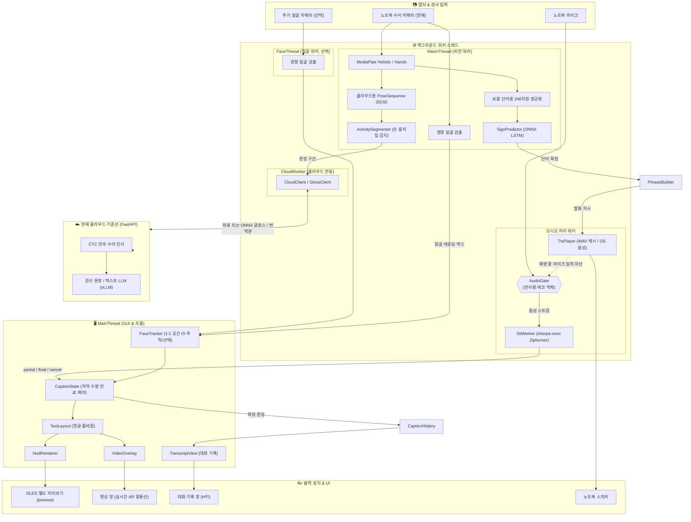
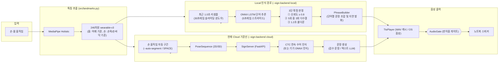
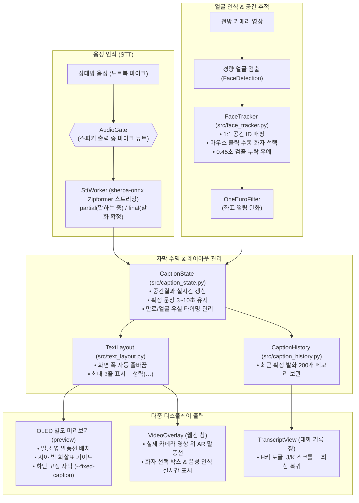

# signglass — 청각장애인 양방향 소통 스마트글래스

수어와 음성 사이를 **양방향으로** 잇는 스마트글래스 프로젝트입니다.
현재는 **노트북 클라이언트 + 클라우드 서버**로 기능을 검증하고, 휴대폰 연동을 다음 단계로 검토합니다.

| 방향 | 이름 | 하는 일 |
|---|---|---|
| 착용자 → 상대방 | **Phase 1** | 수어를 한국어 문장으로 변환하고 TTS로 **음성** 출력 |
| 상대방 → 착용자 | **Phase 2** | 상대의 말을 받아써서 상대 얼굴 옆에 **AR 말풍선** |

두 방향이 동시에 돌아가고, 서로의 소리가 되먹임되지 않도록 반이중 게이트가 사이에 있습니다.

## 현재 개발 방향

| 구분 | 방향과 구현 상태 |
|---|---|
| 현재 클라이언트 | 노트북의 카메라·마이크·스피커 사용. STT, 얼굴 추적, 영상 말풍선, 대화 기록, OLED 별도 미리보기 실행 |
| 수어 번역 목표 | 클라우드에서 **Qwen2.5-VL-7B-Instruct 또는 72B-Instruct** 활용 예정. 아직 VLM 입력·추론 경로는 연결하지 않음 |
| 현재 서버 구현 | 좌표 → CTC 글로스 인식 → 검수 문장 또는 텍스트 언어 모델(vLLM). 현재 기본 텍스트 모델은 `Qwen/Qwen2.5-7B-Instruct`이며 VLM과 다름 |
| 음성 출력 | 현재 WAV 캐시 + OS 내장 음성. 자유 생성 문장용 TTS 엔진은 선정·연결 예정 |
| 다음 클라이언트 | 휴대폰 연동 검토. 현재 Python/OpenCV 앱이 휴대폰에서 실행된다는 의미는 아님 |
| OLED | `HUD (OLED simulation)` 별도 창을 유지. 실제 안경 디스플레이의 구동 인터페이스·광학계는 미확정 |
| Pi·Arduino·Pico | **현재 구성·구매·시연의 전제에서 제외.** 관련 코드는 이전 하드웨어 실험 경로로 보존 |

목표 흐름은 **수어 입력 → 클라우드 VLM → 확정 한국어 문장 → TTS → 상대방에게 음성 전달**입니다.
반대 방향은 **상대방 음성 → 로컬 STT → 얼굴 추적 말풍선·대화 기록**입니다.
VLM용 영상/프레임 입력과 JSON 보조 정보의 구성은 별도 설계가 필요하며, 현재 좌표 API에
모델 이름만 바꿔 VLM 연동이 완료되는 구조는 아닙니다.

**현재 코드에서 실행할 수 있는 수어 경로:**

- **클라우드 기준선:** `--sign-backend cloud`. 문장 단위 관절 좌표를 서버로 보내 CTC 연속
  수어 인식 후 문장을 만듭니다. 문장은 검수 문장 → 언어 모델(vLLM) 순으로 만들고, 실패하면
  미리보기만 표시합니다.
- **시연 대안:** `--sign-backend local`(현재 CLI 기본값). 고립 단어 ONNX 분류와 규칙 문장 조합입니다.
  데이터 확보가 늦어질 때 쓰는 대안이며, 이 경로로 시연할 때는 시연 범위를 따로 밝힙니다.

CLI 기본값은 아직 `local`이며, 클라우드 경로는 옵션으로 선택합니다. 데이터 규격·학습·모의 서버·GPU
실행·자동 발화 검증은 [CLOUD_SETUP.md](CLOUD_SETUP.md)를 참고하세요. 실제 연속 수어 데이터와
모델이 아직 없어 번역 성능은 검증되지 않았습니다.

---

## 지금 상태 (정직하게)

**프로토타입 소스는 대부분 구현됐지만, 제품의 핵심 가설과 전 구간 통합은 아직 검증되지 않았습니다.**

| | 상태 |
|---|---|
| 소스 모듈·회귀 테스트 | ✅ **53개 전원 통과** (PyTorch→ONNX, CTC·모의 클라우드 통합, HTTP 무인 소크, 얼굴 추적 및 말풍선 UI, 3D 손 특징, 자동 구간 검증 포함). CI 자동 실행(`.github/workflows/tests.yml`); 실기기 관통 테스트 미완료 — 직접 할 테스트는 [`TEST_CHECKLIST.md`](TEST_CHECKLIST.md) |
| 얼굴 추적 AR 말풍선 & 대화 기록 | ✅ 실시간 카메라 영상 위 AR 말풍선 오버레이, 1:1 공간 ID 추적 및 클릭 기반 화자 수동 선택, 최근 200개 대화 기록 탐색 창(`--transcript`, H/J/K/L) 구현 완료 |
| 클라우드 수어 번역 | 🟡 CTC+텍스트 언어 모델 기준선과 A/B 측정 도구 구현. Qwen2.5-VL은 도입 예정이며 실제 문장 데이터·GPU 모델·번역 품질 검증 필요 |
| 3D 방향·자동 구간·특징 비교 | 🟡 3D 손바닥 방향/손목 깊이 분기, 손 움직임 자동 구간(`--auto-segment`), 노트북 정면/안경 시점 분기(`--viewpoint`), 특징 구성 비교 도구(`tools/compare_features.py`) 구현 |
| 학습 의존성 | ✅ PyTorch 2.4.1 / ONNX 1.16.2 / onnxruntime 1.19.2 / scikit-learn 1.5.2 설치 확인 |
| 학습된 모델 `models/sign_lstm.onnx` | ❌ 없음 — 수어 단어 데이터 수집 및 학습 필요 |
| 직접 수집한 데이터 `data/raw/**/*.npy` | ❌ 0개 |
| AI Hub 샘플 | 🟡 3D 변환 완료: 100클립→21시퀀스/20동작 그룹; 한국어 뜻 매핑·추가 화자 필요 (`data/processed/aihub3d`) |
| 한국어 STT | ✅ 기본 sherpa-onnx 스트리밍 Zipformer(`models/sherpa-ko-174m-chunk32/`) 준비 완료. 비교 모델(`sherpa-ko-2024-06-16/`, `models/vosk-ko/`) 및 합성음성 22문장 무결성 검증 완료 |
| TTS | 🟡 macOS 22개 WAV 캐시 및 OS 음성 fallback 구현. 새 문장용 TTS 모델·API 연결 예정 |
| 한글 픽셀 폰트 `assets/fonts/Galmuri11.ttf` | ✅ Galmuri v2.40.4 + LICENSE.txt 설치 확인 |
| 실제 안경 디스플레이·휴대폰 연동 | 🟡 OLED 소프트웨어 미리보기 유지. 실물 디스플레이 구동·광학 정렬과 휴대폰 클라이언트는 미구현 |

현재 시연은 노트북 웹캠과 내장 오디오를 기준으로 진행합니다. 먼저 수어 입력부터 문장·음성
출력까지와 STT부터 말풍선까지의 경로를 검증하고, 실제 안경 장착은 디스플레이 연결 방식과
손·얼굴 검출률을 측정한 뒤 진행합니다. 두 카메라(`--face-camera`)는 필요할 때 비교하는
선택 경로이며, `--fixed-caption`은 얼굴 추적 없는 자막 대안으로 유지합니다.

2명·12주 기준 권장 범위, 주차별 게이트, 평가 지표는
[`PROJECT_REVIEW.md`](PROJECT_REVIEW.md)에 정리했습니다.
경진대회 당일 전체/폴백 모드와 2인 역할은 [`DEMO_RUNBOOK.md`](DEMO_RUNBOOK.md)를 따릅니다.
AI Hub 3D 활용 및 이전 검토 정정은 [`AIHUB_TRANSFER.md`](AIHUB_TRANSFER.md)에 정리했습니다.
vLLM·클라우드 구조 평가, 성능·리팩토링 목록, LLM 학습 판단, AI Hub 확장 계획은
[`REVIEW_AND_PLAN.md`](REVIEW_AND_PLAN.md)에 있습니다. 사람이 장비·데이터로 직접 해야 하는
테스트와 의미 검수 절차는 [`TEST_CHECKLIST.md`](TEST_CHECKLIST.md)에 있습니다.

---

## 현재 구현 아키텍처

`signglass`는 GUI와 디스플레이 출력을 담당하는 메인 스레드와 비전·STT·TTS·클라우드 통신을 전담하는 백그라운드 워커 스레드로 분리되어 있습니다.
MediaPipe와 ONNX의 네이티브 연산은 일부 병렬 실행이 가능하지만 실제 처리량은 장치에서 측정해야 합니다.
아래 그림은 **현재 구현된 CTC 기준선과 노트북 UI**입니다. 도입 예정인 Qwen2.5-VL과
휴대폰 클라이언트, 미확정인 실물 OLED 연결을 구현 완료된 구성으로 표시하지 않습니다.

### 1. 전체 시스템 구조 및 스레드 데이터 흐름



> **큐 병목 제어**: 비전 및 디스플레이 프레임 큐는 `maxsize=1`로 최신 프레임만 유지하여 오래된 입력을 버립니다. 오디오 큐는 약 1초 분량으로 엄격히 제한하여 지연 누적을 방지합니다.

---

### 2. Phase 1 — 수어 → 음성 (착용자 → 상대방)

현재 구현은 로컬 단어 인식 또는 클라우드 CTC 기준선의 결과를 노트북 스피커로 출력합니다.
Qwen2.5-VL 도입 시 수어 입력·서버 추론 경로를 추가하고, 확정 문장을 TTS에 전달하도록 확장합니다.



1. **랜드마크 추출 & 착용형 정규화 (`src/landmarks.py`)**:
   - MediaPipe Holistic(포즈 33 + 양손 21×2 + 얼굴 468점)으로부터 246차원 `wearable-v3` 벡터 추출.
   - 몸은 어깨 기준, 손은 손목/손바닥 기준으로 분리 정규화하여 카메라 화각에서 어깨가 잘려도 손 특징을 보존.
2. **Local 경로 추론 (`src/predictor.py`)**:
   - `ADAPTIVE_WINDOW`: 최근 1.0초간의 프레임을 30개로 리샘플링하여 FPS 변동에 강인하게 유지.
   - 5프레임 스트라이드로 ONNX LSTM 추론 후 **3단 확정**(신뢰도 ≥ 0.8, 5회 중 3회 다수결, 1.2초 쿨다운) 적용.
   - `PhraseBuilder`가 연속 단어를 조합해 완성된 문장 도출 (예: "이름" + "무엇" → "이름이 뭐예요?").
3. **Cloud 경로 연속 수어 (`src/cloud_sign.py`, `src/sign_server.py`)**:
   - 손 움직임 기반 자동 구간 분할(`ActivitySegmenter`) 또는 키 입력(SPACE)으로 발화 구간 검출.
   - 시퀀스 좌표 전송 후 CTC 모델 디코딩 및 언어 모델(vLLM) 기반 자연어 문장 생성.
4. **TTS 출력 (`src/tts_player.py`)**:
   - 미리 생성한 16kHz WAV 캐시를 비동기 재생하며, 캐시에 없으면 OS 음성으로 대체.
   - 캐시는 합성 대기를 줄이지만 큐·재생 장치 지연은 남습니다. 자유 생성 문장용 TTS 엔진은 후속 작업입니다.

---

### 3. Phase 2 — 음성 → AR 말풍선 (상대방 → 착용자)

상대방의 음성을 실시간 받아쓰기하여 상대 얼굴 옆에 AR 말풍선으로 배치하는 파이프라인입니다.



1. **스트리밍 STT & 반이중 게이트 (`src/stt_worker.py`, `src/audio_gate.py`)**:
   - `sherpa-onnx` Zipformer 스트리밍으로 상대방 말을 즉각 텍스트화 (`partial` 중간 결과 및 `final` 확정 이벤트).
   - 착용자가 수어로 말하여 TTS가 출력되는 동안에는 `AudioGate`가 마이크를 차단하여 자막 루프(에코) 방지.
2. **공간 얼굴 추적 (`src/face_tracker.py`)**:
   - 얼굴 검출 결과에 공간 추적 ID를 부여하여 첫 인식 결과 시각의 선택 대상에 자막 연결.
   - 마우스 좌클릭으로 대화 상대를 선택하며, `OneEuroFilter`로 위치 떨림을 완화. 실제 발화자 자동 판별은 미구현.
3. **자막 수명 & 레이아웃 (`src/caption_state.py`, `src/text_layout.py`)**:
   - 발화 중에는 실시간 갱신, 발화 종료 후 문장 길이에 따라 3~10초간 말풍선 유지.
   - 화면 폭에 맞춘 자동 개행 및 최대 3줄 표시.
4. **다양한 출력 경로**:
   - **OLED 별도 미리보기**: `HudRenderer`를 거쳐 `HUD (OLED simulation)` 창에 표시. 내 번역과 상대 자막의 두 영역 유지.
   - **비디오 오버레이**: 웹캠 영상 창 위에 AR 말풍선과 화자 추적 박스를 오버레이 (`--video-captions`).
   - **대화 기록 창**: OpenCV 창에 포커스를 두고 `H`로 기록 창을 열어 스크롤 탐색 (`--transcript`).

---

## 모듈 지도

```
config.py            ★ 모든 튜닝은 여기서만. 다른 모듈은 여기만 바라봄
main.py              ★ 통합 실행 (비전 스레드 + 메인 루프)

src/
  landmarks.py       ★ 랜드마크 추출·정규화 (246차원 wearable-v3). 핵심 모듈
  camera.py            공용 카메라 (수동 노출 + 끊김 재연결)
  one_euro.py          저지연 좌표 스무딩 (One Euro Filter)
  predictor.py       ★ 슬라이딩 추론 + 3단 확정 + 문장 조합 (PhraseBuilder)
  runtime.py         ★ 통합 추론 런타임 (onnx / torch / keras)
  joints.py            MediaPipe·OpenPose 공통 관절 정의 (단일 출처)
  features_v2.py       AI Hub(OpenPose) ↔ MediaPipe 공통 부분집합, 101차원 (레거시)
  hand_shape3d.py      AI Hub 3D ↔ MediaPipe Hands world 공통 손 모양, 462차원
  hud.py             ★ 좌표변환 + 말풍선 렌더 + SSD1306 패킹 + 표시 내용 선택(HudContent)
  oled_bridge.py       preview / null + 이전 실물 연결 코드(serial / pi, 현재 미사용)
  stt_worker.py        스트리밍 STT 스레드 (sherpa-onnx 기본, vosk 대체)
  tts_player.py        비동기 TTS 재생 워커
  audio_gate.py        반이중 게이트 (스피커 출력 중 마이크 뮤트, 에코 루프 차단)
  latency.py           지연 측정 하네스 (p50 / p95, 최근 표본·실행 전체 구분)
  clock.py             경과 시간 시계(clock.now) / Unix 시각(clock.unix_time) 분리
  pose_sequence.py     cloud 경로 좌표 규격(2D/3D)과 특징 변환
  continuous_sign.py   CTC 연속 인식 모델 정의·학습·추론 (PyTorch)
  ctc_runtime.py       torch 없는 CTC 디코딩·ONNX 추론 (기기 인식 비교 경로 B)
  translation.py       용어집·검수 문장·언어 모델(vLLM)·실패 시 미리보기
  sign_server.py       번역 API 서버 (FastAPI)
  cloud_sign.py        장치 쪽 구간 녹화·서버 클라이언트
  cloud_control.py     cloud 경로 명령·결과 처리
  segmenter.py         손 움직임 기반 자동 문장 구간 (ActivitySegmenter)
  data_sources.py      학습 데이터 출처 (manifest → 모델 → /health)
  dataset_contract.py  데이터셋 규격 및 메타데이터 계약 검증
  collect.py           Step 1-1 단어 데이터 수집기
  collect_continuous.py 문장 단위 연속 수어 좌표 수집기
  train.py             Step 1-2 LSTM 단어 모델 학습
  train_continuous.py  CTC 연속 수어 모델 학습 스크립트
  face_tracker.py    ★ 다중 얼굴 검출, 1:1 공간 ID 추적 및 화자 선택
  caption_state.py   ★ 자막 수명 주기(홀드/만료/얼굴 연결) 상태 머신
  caption_history.py   최근 200개 확정 대화 기록 메모리 보관
  text_layout.py       한글 폰트 로딩·화면 폭 맞춤 줄바꿈
  video_overlay.py   ★ 카메라 영상 위 실시간 AR 말풍선·얼굴 테두리 렌더링
  transcript_view.py   OpenCV 기반 대화 기록 GUI 창 (H키 토글, J/K 스크롤)
  calibrate.py         시차(parallax) 보정 도구
  build_tts_cache.py   TTS wav 사전 생성 (1회)

tools/
  evaluate.py          ★ 저장된 ONNX 를 홀드아웃셋으로 평가
  evaluate_continuous.py 연속 수어 CTC 모델 홀드아웃셋 평가
  demo.py              ★ 데모 시나리오 재생·녹화 (카메라·모델 불필요)
  to_onnx.py           외부/레거시 모델 → ONNX 변환 (기본 학습은 자동 변환)
  inspect_model.py     모델 형식 자동 판별·요약
  inspect_aihub.py     AI Hub 데이터셋 스캐너
  merge_parts.py       AI Hub 분할압축 병합
  check_mount.py       실제 장착 시점 손/얼굴 검출률과 FPS 측정
  prepare_aihub3d.py   3D 손 데이터 변환·중복 제거·원본 동작 그룹 감사
  verify_assets.py     모델/폰트/TTS 및 합성음성→STT 무결성 검사
  prepare_continuous.py  OpenPose JSON → 문장 좌표 데이터셋
  extract_mediapipe.py   원본 영상 → 실행 시와 같은 MediaPipe 좌표 데이터셋
  compare_extractors.py  두 데이터셋의 좌표 차이·프레임 어긋남·좌우 손 비교
  compare_features.py    특징 구성별(2D/3D/정규화) 성능·손실 비교
  export_ctc_onnx.py     CTC 체크포인트 → ONNX (PyTorch 동등성 검사 포함)
  benchmark_paths.py     서버 인식(A) / 기기 인식(B) 배치 비교: 지연·전송량·CPU
  evaluate_rounding.py   좌표 반올림이 크기·특징·인식에 주는 영향
  compare_stt.py         STT 엔진 비교: CER·RTF·자막 시점
  review_sentences.py    의미 검수 시트 내보내기/가져오기 (검수 문장·보정 연결)
  evaluate_segments.py   자동 구간 평가: 경계 지연·잘림·분할·오검출
  send_pose.py           포즈 시퀀스 파일/더미 데이터 서버 전송 및 응답 테스트
  soak.py                HTTP 무인 소크 (장애 주입, 발화 감사, 메모리·스레드)

tests/
  run_all.py           전체 테스트 실행 (pytest 불필요)
  test_*.py            회귀 테스트 53종 (전원 통과)

firmware/
  oled_bridge.ino      이전 USB↔SPI 브리지 펌웨어 (현재 구성에서 미사용, 보존)
```

```bash
python tests/run_all.py          # 전체
python tests/run_all.py -v       # 출력까지
python tests/run_all.py adaptive # 이름으로 골라서
```

테스트 실행기는 `pytest` 없이 표준 라이브러리로 동작합니다. 개별 테스트는 실행·학습·서버
의존성이 필요하며, 일부 선택 의존성이 없으면 건너뜁니다. 현재 기준 환경은 개발 노트북입니다.
각 테스트는 독립 프로세스로 실행됩니다 — 여러 테스트가 `config`를 임시로
갈아끼우기 때문에 한 프로세스에서 몰아 돌리면 서로 오염됩니다.

---

## 실행 구성과 이전 하드웨어 경로

### 현재 구성: 노트북 + 클라우드

```
노트북 카메라·마이크
  ├─ 수어 입력 ──▶ 클라우드 서버 ──▶ 한국어 문장 ──▶ TTS·노트북 스피커
  └─ STT + 얼굴 추적 ──▶ 영상 말풍선 / 대화 기록 / OLED 별도 미리보기
```

실행 환경은 `requirements.txt`, 기본 디스플레이는 `--display preview`입니다.
영상 말풍선만 보려면 `--display null --video-captions`로 선택할 수 있습니다.
이 옵션은 OLED 미리보기 창을 숨길 뿐 관련 코드를 삭제하지 않습니다.

휴대폰 연동은 다음 클라이언트 후보이며 아직 구현되지 않았습니다. 안경은 입력·표시 장치로
연동하는 방향을 검토하고, VLM은 클라우드에서 실행합니다. 실제 OLED 패널은 별도 구동
인터페이스가 필요하므로, 연결 방식을 확정하기 전 노트북·휴대폰에 바로 연결된다고 가정하지 않습니다.

### 이전 하드웨어 경로: 코드만 보존, 현재 사용 계획 없음

| 보존된 경로 | 관련 파일·옵션 | 현재 취급 |
|---|---|---|
| PC → Arduino/Pico → OLED | `--display serial`, `firmware/oled_bridge.ino` | 현재 구성·구매·시연에 포함하지 않음 |
| Pi GPIO → OLED | `--display pi`, `requirements-pi.txt` | 현재 구성·구매·시연에 포함하지 않음 |

이전 하드웨어 연결 코드와 OLED 별도 미리보기는 삭제하지 않습니다. 관련 설치·배선 절차는
현재 팀원의 필수 준비 사항이 아니며, 실제 디스플레이 연결 방식이 결정되면 다시 검토합니다.

---

## 설계 결정과 근거

이 프로젝트에서 "왜 이렇게 했는가"가 중요한 지점들입니다.

| 결정 | 근거 |
|---|---|
| **246차원** (얼굴 468점 전부가 아니라 24점) | 흔한 튜토리얼은 1662차원을 넣는데, 그러면 얼굴이 전체의 84%를 차지해 손 정보가 묻힙니다 |
| **착용형 손 정규화** | 몸은 어깨 기준, 손 모양은 손목/손바닥 기준으로 둡니다. 어깨가 잘려도 손이 0이 되지 않고, 손목 위치·크기도 보존합니다 |
| **얼굴은 눈 사이 거리로 따로 정규화** | 어깨 스케일로 나누면 표정 변화가 뭉개집니다. 한국수어의 의문·부정은 손이 아니라 표정입니다 |
| **STRIDE=5 슬라이딩 윈도우** | 30프레임을 다 채우고 추론하면 체감 지연 1초. 5프레임마다면 170ms |
| **3단 확정 (임계값+다수결+쿨다운)** | 한 번의 높은 신뢰도로 발화하면 손이 지나가기만 해도 말을 합니다 |
| **NEUTRAL 클래스 필수** | 없으면 가만히 있어도 아무 단어나 뱉습니다. 전체 데이터의 20~25%를 여기에 |
| **PhraseBuilder 지연 발화** | 즉시 발화하면 "이름" 뒤에 "이름이 뭐예요?"가 또 나와 두 번 들립니다 |
| **TTS 사전 캐싱** | 고정 시연 문장은 WAV를 재사용해 합성 대기를 줄입니다. 자유 생성 문장은 동적 TTS가 필요하며, 재생 지연·실패 가능성은 별도 검증합니다 |
| **반이중 게이트** | 노트북이나 안경에서 스피커 출력이 마이크로 다시 들어오는 자막 에코를 차단합니다 |
| **local 인식 실행은 ONNX** | torch 200MB / TF 600MB vs onnxruntime 50MB. cloud 경로의 CTC·언어 모델은 서버에서 실행합니다 |
| **One Euro Filter** | 이동평균은 부드럽게 할수록 지연이 그대로 늘어납니다. AR 오버레이 표준 |
| **화자 단위 평가** | 시퀀스 단위로 섞으면 "97%인데 남이 하면 30%"가 나옵니다 |
| **좌우 반전 증강 안 함** | 수어는 주손(dominant hand)이 의미를 가져서 뒤집으면 다른 동작이 됩니다 |

---

## 실행 및 팀 환경 준비

### 팀 협업 · GitHub 클론 후 준비

이 저장소는 **코드와 재현 절차만** GitHub으로 공유합니다. 각 컴퓨터에서 만들어지거나
용량·배포 조건을 따르는 파일은 `.gitignore`로 제외합니다. 따라서 `git clone`만으로는
STT와 수어 인식 전체를 실행할 수 없습니다.

| 항목 | GitHub 커밋 | 팀원이 준비할 방법 |
|---|---:|---|
| 소스코드·문서·`requirements*.txt`·테스트 | 포함 | `git clone` |
| Python 가상환경과 PyTorch / ONNX / Vosk **패키지** | 제외 | 아래 `pip install` 실행 |
| 기본 STT 모델 `models/sherpa-ko-174m-chunk32/` | 제외 | 아래 "STT 모델" 명령으로 내려받기 (약 160MB) |
| 대체 STT: Vosk 한국어 모델 `models/vosk-ko/` | 제외 | [공식 다운로드](https://alphacephei.com/vosk/models/vosk-model-small-ko-0.22.zip)를 같은 경로에 압축 해제 (`--stt vosk`일 때만) |
| 학습 완료 ONNX 모델 `models/sign_lstm.onnx` | 제외 | [이 프로젝트 Releases](../../releases) / 팀 Drive에서 내려받거나 직접 학습 |
| AI Hub 원본·전처리 데이터 | 제외 | [AI Hub](https://aihub.or.kr/) 권한에 따라 별도 다운로드·전처리 |
| TTS wav 캐시·폰트 | 제외 | 아래 생성 명령 또는 팀 배포본 사용. 폰트는 [Galmuri Releases](https://github.com/quiple/galmuri/releases)에서 받음 |

여기서 **ONNX는 패키지와 모델 파일이 다릅니다.** `onnx`는 학습·변환용 Python
라이브러리이고, `sign_lstm.onnx`는 학습 후 만들어지는 실제 배포 모델입니다. 전자는
`requirements-train.txt`로 설치하고, 후자는 현재 GitHub에 올라가지 않습니다.

#### 새 팀원 초기 설정

```bash
git clone <저장소-주소>
cd signglass

# Python 3.11 권장
python3.11 -m venv .venv
source .venv/bin/activate          # Windows PowerShell: .venv\\Scripts\\Activate.ps1
pip install -r requirements.txt    # 실행 환경
pip install -r requirements-train.txt  # 학습·ONNX 변환도 할 경우만

python check_env.py
```

그 다음 기본 STT 모델을 받습니다(**STT 모델**). 파일 4개, 약 160MB입니다.

```bash
d=models/sherpa-ko-174m-chunk32; mkdir -p $d
u=https://huggingface.co/kangkyu/icefall-asr-ko-streaming-zipformer-174m/resolve/main
for f in encoder decoder joiner; do
  curl -L -o $d/$f-epoch-99-avg-1-chunk-32-left-128.int8.onnx \
       $u/$f-epoch-99-avg-1-chunk-32-left-128.int8.onnx
done
curl -L -o $d/tokens.txt $u/tokens.txt
python tools/compare_stt.py --tts-cache     # vosk 와 비교 (합성음성)
```

예전 엔진을 쓰려면 [Vosk 한국어 모델 ZIP](https://alphacephei.com/vosk/models/vosk-model-small-ko-0.22.zip)을
받아 압축을 풀고 폴더 이름을 `models/vosk-ko/`로 맞춘 뒤 `--stt vosk`로 실행합니다. [Galmuri v2.40.4 ZIP](https://github.com/quiple/galmuri/releases/download/v2.40.4/Galmuri-v2.40.4.zip)에서
`Galmuri11.ttf`와 `LICENSE.txt`를 `assets/fonts/`에 넣은 뒤 TTS 캐시를 생성합니다.

```bash
python -m src.build_tts_cache --engine macos  # macOS
# Windows에서는 --engine edge 사용 또는 팀에서 만든 wav 캐시를 전달
```

모델 학습이 끝나면 `sign_lstm.onnx`와 라벨/전처리 메타데이터를 **[이 프로젝트 Releases](../../releases)
또는 팀 공유 Drive**에 함께 배포하세요. `.venv`, AI Hub 원본, Vosk 모델을 Git에 강제로 넣으면
저장소가 무거워지고 배포·라이선스 관리가 어려워집니다. 커밋 전에는 아래 명령으로 제외 대상이
정상인지 확인합니다.

```bash
git status --short
git status --ignored  # .venv, models/sherpa-ko-*, models/vosk-ko, data/raw 등이 ignored로 보여야 함
```

### 준비 (한 번만)

```bash
python check_env.py                  # 환경 점검 — 전부 [OK] 여야 함
# models/sherpa-ko-174m-chunk32/  ← 기본 STT 모델 ("STT 모델" 명령)
# models/vosk-ko/  ← --stt vosk 를 쓸 때만
# assets/fonts/Galmuri11.ttf  ← 저해상도 한글 픽셀 폰트
python -m src.build_tts_cache        # TTS wav 사전 생성 (인터넷 필요, 1회)
```

### 데이터 → 모델

```bash
# 촬영자/촬영일마다 config.py 의 SIGNER_ID / SESSION_ID 를 바꾸세요
python -m src.collect                # SPACE 녹화 / n,p 라벨이동 / u 취소 / q 종료
pip install -r requirements-train.txt
python -m src.train --split group    # ONNX까지 생성. 촬영자 3명 이상 권장
python tools/evaluate.py --split group             # 배포하는 그 파일을 평가
```

### 실행

| 명령 | 용도 |
|---|---|
| `python main.py --debug` | 통합 실행 + 카메라 뷰 |
| `python main.py --video-captions --transcript` | 카메라 영상 위 실시간 AR 말풍선 + 대화 기록 탐색 창 |
| `python main.py --sign-backend cloud --auto-segment` | 클라우드 연속 수어 번역 (손 움직임 자동 구간 분할) |
| `python main.py --sign-backend cloud --viewpoint webcam` | 노트북 정면 웹캠 시점 자동 구간 규칙 (손 내리면 문장 종료) |
| `python main.py --sign-backend cloud --recognize device --onnx <PATH>` | 기기 인식(B 경로): 온디바이스 CTC ONNX 추론 후 서버로 글로스만 전송 |
| `python main.py --no-stt` | Phase 1(수어→음성)만 |
| `python main.py --no-sign` | Phase 2(음성→자막)만 — **수어 모델 없이도 동작** |
| `python main.py --no-sign --fixed-caption` | 카메라 없이 하단 고정 자막 — 현장 안정형 폴백 |
| `python main.py --sign-camera 0 --face-camera 1` | 하향 수어/전방 얼굴 두 카메라 통합 |
| `python main.py --stats` | 지연을 구간별로 측정해 종료 시 p50/p95 출력 |
| `python main.py --stats out.csv` | 위 + 원본 표본을 CSV로 (보고서 그래프용) |
| `python main.py --no-gate` | 반이중 해제 (유선 이어폰으로 들을 때만) |
| `python tools/demo.py --record demo.mp4` | 데모 시나리오 재생·녹화 |
| `python tools/check_mount.py --duration 30 --preview` | 장착 시점 손/얼굴 검출률 측정 |
| `python tools/compare_features.py` | 특징 구성(2D/3D/정규화)별 손실 및 성능 비교 |
| `python -m src.hud` | 보존된 OLED 말풍선 레이아웃 미리보기 |
| `python tests/run_all.py` | 회귀 테스트 53종 전체 실행 |

`DISPLAY_BACKEND = "preview"`면 추가 디스플레이 하드웨어 없이 OLED 별도 미리보기를
사용할 수 있습니다. 소프트웨어 레이아웃은 확인할 수 있지만 실제 광학 정렬·착용 가독성은
실물 검증이 필요합니다. 클라우드 GPU·API 비용은 별도로 계산합니다.

### 카메라 영상 위 실시간 말풍선

```bash
# 수어 모델 없이 STT + 얼굴 옆 말풍선 시연 (한국어 STT 모델은 필요)
python main.py --no-sign --no-tts --display preview --video-captions --transcript

# 영상 창만 사용하고 OLED 시뮬레이션은 표시하지 않기
python main.py --no-sign --no-tts --display null --video-captions

# 기존 OLED 미리보기만 사용
python main.py --no-sign --display preview --no-video-captions
```

`preview` 출력에서 얼굴 카메라를 사용하면 영상 말풍선 창도 기본 활성화됩니다.
`--fixed-caption`은 카메라 없는 고정 자막 경로를 유지합니다. 별도 얼굴 카메라를
쓰면 말풍선은 그 영상 위에 표시하며, 한 카메라에서는 미러링된 영상과 얼굴
좌표를 함께 뒤집습니다. OLED 별도 미리보기는 기존 시야/광학 보정 좌표를 유지합니다.

- 얼굴 한 명을 기준으로 공간 추적 ID를 만들고, 각 발화의 첫 인식 결과를
  해당 시각의 선택된 ID에 연결합니다. 처음부터 여러 얼굴이 보이면 하단 자막을
  사용합니다. 얼굴별 번호와 선택 테두리는 영상에 함께 표시합니다.
- 영상의 얼굴을 **왼쪽 클릭**하면 대화 상대를 수동 선택합니다. 선택 변경은
  다음 발화부터 적용하며 진행 중인 자막은 하단으로 이동합니다. 선택한 얼굴이
  사라지면 다른 사람으로 자동 전환하지 않습니다. **우클릭**으로 자동 모드로
  돌아가면 한 명인 경우 다시 선택합니다. 자동 모드는 말하는 사람을 판별하는
  기능이 아니라 한 명의 대화 상대를 유지하는 기능입니다.
- 말풍선은 얼굴 영역 바깥의 좌우 공간에 배치하고, 공간이 부족하면 하단으로
  이동합니다. 한글은 화면 폭에 맞춰 줄바꿈하며 최대 3줄의 최근 내용을 표시합니다.
  생략된 앞부분은 `…`로 표시합니다. 확정 문장 전체는 대화 기록 창과 터미널의
  `[음성]` 로그에서 확인할 수 있습니다.
- 중간 결과는 같은 말풍선을 갱신합니다. 확정 후 최소 3초, 긴 문장은 최대
  10초 유지합니다. 중간 결과가 8초 동안 갱신되지 않으면 숨깁니다.
- 얼굴 검출 누락은 0.45초까지 허용합니다. 추적이 만료되거나 모호해지면
  해당 발화의 얼굴 연결을 해제하며, 새 얼굴에 이전 문장을 옮겨 붙이지 않습니다.
  카메라 영상이 1초 이상 갱신되지 않으면 검은 배경에 고정 자막을 표시합니다.
- TTS로 마이크가 차단되면 진행 중인 발화는 취소합니다. 완료된 자막은 유지
  시간 정책을 따릅니다. 시간 설정은 `config.py`의 `CAPTION_*`, `FACE_LOST_SEC`입니다.
- **H**로 대화 기록 창을 열거나 닫습니다. `--transcript`를 주면 처음부터 엽니다.
  휠 또는 **K/J**로 이전/다음 내용을 보고 **L**로 최신 문장으로 돌아갑니다.
  최근 확정 발화 200개를 메모리에만 보관하며, 앱 종료 시 지워집니다.
  `CAPTION_HISTORY_LIMIT`으로 개수를 변경할 수 있습니다. 중간 결과, 취소 결과,
  중복 확정 결과는 기록에 추가하지 않습니다. 화자 번호는 선택 대상을 뜻하며
  실제 음성 화자 식별 결과가 아닙니다.

자막만 사용하는 `--no-sign`에서는 얼굴 검출만 실행하며 수어용 Holistic은
실행하지 않습니다. 영상 말풍선은 최대 30fps로 갱신하고 기록 창은 내용이나
스크롤 위치가 바뀔 때 갱신합니다.

현재는 **1:1 대화용 공간 추적**이며 음성 화자 분리, 입 움직임 기반 화자 판별,
얼굴 신원 인식은 포함하지 않습니다. 한 사람만 보여도 화면 밖 음성을 그 사람의
말과 구분하지 못합니다. 비슷한 위치에서 사람이 교체되거나 교차하는 상황도
기하학적 추적만으로 완전히 구분할 수 없습니다. STT 이벤트의 `observed_at`은 인식 결과 생성 시각으로,
정확한 음성 시작/종료 시각을 의미하지 않습니다.

---

## 학습 데이터 두 경로

| | 경로 A — 직접 수집 | 경로 B — AI Hub |
|---|---|---|
| 특징 | `landmarks.py` **246차원 wearable-v3** | `hand_shape3d.py` **462차원 3D 손 모양** |
| 얼굴(비수지신호) | 검출 시 포함 | 원본에 존재하나 현재 손 모양 분기에는 미포함 |
| 수집 | `src/collect.py` | AI Hub 다운로드 |
| 학습 | `src/train.py` 있음, ONNX 변환 테스트 통과 | 학습 입력 변환 완료, 사전학습 모델은 미구현 |
| 상태 | 실제 장착 데이터 수집 필요 | 단어당 1동작 그룹: 추가 표본·뜻 매핑 필요 |

직접 수집 경로는 `data/raw/dataset_meta.json`에 특징 버전·차원·길이·FPS를 기록합니다.
파일명은 `{촬영자}__{세션}_{번호}.npy`이며, 메타데이터 없는 구형 배열이나 다른 특징 버전이
섞이면 학습 전에 중단합니다.

보유 AI Hub에는 2D뿐 아니라 손 3D와 카메라 보정값도 있습니다. 새 경로는 정규화한 3D
관절 간 거리로 손 모양을 표현해 강체 회전에 불변하게 만듭니다. 기존 `features_v2.py`의
2D 정렬만으로는 1인칭/3인칭 차이를 제거할 수 없습니다. 손 모양 사전학습에 AI Hub를 쓰고
착용 데이터로 방향·이동·검출 오차를 보완하는 경로를 검증할 수 있습니다.

```bash
python tools/merge_parts.py <다운로드폴더> --run --extract   # 분할압축 병합
python tools/inspect_aihub.py <데이터루트>                   # 구조·형식 스캔
python tools/prepare_aihub3d.py data/raw/New_sample --out data/processed/aihub3d-new
```

---

## 데이터 출처·라이선스

**학습 데이터**

> 이 프로젝트는 한국지능정보사회진흥원의 사업결과물인 AI 허브 '수어 영상' 데이터를
> 활용했습니다(https://aihub.or.kr/aidata/7965).

- AI 허브 이용정책은 결과물에 한국지능정보사회진흥원(NIA)의 사업결과임을 밝히도록 합니다.
  학습한 모델 같은 2차적 저작물에도 같은 표기가 필요하므로 발표 자료·보고서·포스터와
  모델 배포에 위 문구를 함께 적습니다.
- 데이터 구축: 테스트웍스(주관), 나사렛대학교, KAIST RCV, 이큐포올, 한국농아인협회(참여).
- 승인 없이 데이터를 제3자에게 제공·양도·판매할 수 없습니다. 원본·전처리 데이터는
  저장소에 넣지 않습니다(`.gitignore`). 신청은 내국인만 가능합니다.
- 데이터 변환 도구가 manifest에 출처를 적고(`--source`), 학습이 체크포인트 metadata
  `data_sources`로, ONNX 내보내기가 사이드카로 옮깁니다. 서버 `/health`의 `data_sources`가
  표기 문구를 돌려줍니다. 팀이 직접 녹화한 데이터는 `team`으로 기록됩니다.
- 출처 기록 전에 변환한 데이터는 학습할 때 경고가 나옵니다. 다음 명령으로 채웁니다.
  `python -m src.data_sources data/processed/.../manifest.json --source aihub-sign-video`
- 다른 AI 허브 데이터셋(예: 재난 안전 수어)을 쓰면 그 데이터셋 이름으로 같은 표기를 추가합니다.

**외부 모델·자원**

| 자원 | 출처 | 라이선스·비고 |
|---|---|---|
| 기본 STT 모델 | [kangkyu/icefall-asr-ko-streaming-zipformer-174m](https://huggingface.co/kangkyu/icefall-asr-ko-streaming-zipformer-174m) | Apache-2.0 (모델 카드). KsponSpeech + AI 허브 음성으로 학습됐다고 밝힘 |
| 비교용 STT 모델 | [k2-fsa sherpa-onnx 2024-06-16 한국어](https://k2-fsa.github.io/sherpa/onnx/pretrained_models/online-transducer/zipformer-transducer-models.html) | 페이지에 라이선스 명시 없음 — 배포 전 확인 |
| STT 런타임 | [sherpa-onnx](https://github.com/k2-fsa/sherpa-onnx) 1.13.8 | Apache-2.0 |
| 대체 STT | [Vosk small-ko 0.22](https://alphacephei.com/vosk/models) | Apache-2.0 |
| 포즈 추출 | MediaPipe Holistic 0.10.21 | Apache-2.0 |
| HUD 폰트 | [Galmuri](https://github.com/quiple/galmuri) v2.40.4 | SIL OFL 1.1 (`assets/fonts/LICENSE.txt`) |

## 알려진 제약

- **MediaPipe 버전 고정 필수.** 0.10.31+에는 `solutions.holistic`이 삭제됐고
  Tasks API에 대체품이 없습니다. numpy도 `<2`여야 합니다.
- **macOS는 OpenCV 노출 제어가 안 먹습니다.** 수어 인식이 깨지는 최대 원인은
  해상도가 아니라 모션 블러라, 조명을 밝게 하거나 수집·시연을 Windows에서 통일하세요.
- **두 카메라는 선택 기능입니다.** 얼굴 AR 성공률은 높이지만 USB 대역폭·CPU·발열이 늘어납니다.
  실측이 기준을 못 넘으면 기능을 삭제하지 말고 `--fixed-caption`을 라이브 시연 기본값으로 둡니다.
- **wearable-v3 이전 데이터/모델과 섞지 마세요.** 특징 차원은 246으로 같아도 손 정규화 의미가
  다릅니다. 새 장착 시점으로 수집하고, 모델의 `feature_version` 검사를 통과시켜야 합니다.
- **시차 보정은 광학 결합기를 쓸 때만 의미가 있습니다.** 직시형이면 `calibrate.py`가
  사실상 놀게 됩니다.
- **실물 OLED 규격은 미확정입니다.** 현재 보존된 렌더러·패킹은 128×64 SSD1306/SSD1309
  기준입니다. 다른 해상도·컨트롤러 패널은 드라이버·프레임버퍼 호환 확인이 필요합니다.
